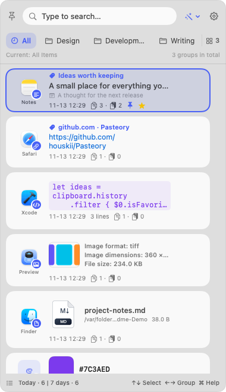
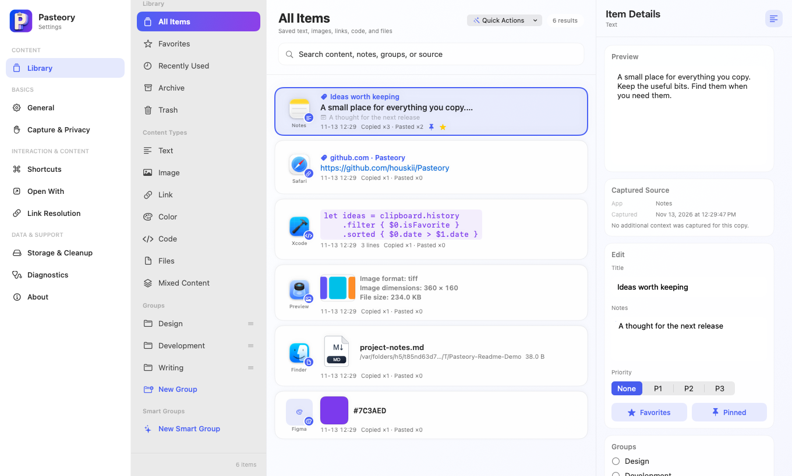

# Pasteory

**English** | [简体中文](README.zh-CN.md)

**Pasteory learns from what you copied.**

A local-first clipboard manager for macOS. Keep text, images, links, code, colors, and file references within reach—then find and paste them without leaving your work.

[Download the latest Beta](https://github.com/houskii/Pasteory/releases) · [All releases](https://github.com/houskii/Pasteory/releases)

## Your clipboard, a shortcut away

Press **⌘⇧V** to open the Quick Panel. Search your history, switch groups, and paste a previous copy into the app you’re using.

- **Find it again.** Search content, titles, notes, groups, or the source app.
- **Keep useful things close.** Favorite, pin, group, or stack related clips. Smart groups collect matching items automatically.
- **Paste your way.** Paste the original content or use plain text. Open links, code, and files in your preferred apps.
- **Make it yours.** Choose a theme color, a tab layout, custom shortcuts, and English or 简体中文. English is the first-launch default.
- **Stay up to date.** Review release notes and confirm an update before Pasteory downloads and installs it.

## A Library for the things you keep

Open the Library with **⌘L** from the Quick Panel to browse your saved content, add notes, and organize it in a larger, resizable window.

## Get started

Requires **macOS 14 or later** on an **Apple Silicon Mac**.

1. Download the Beta DMG from [Releases](https://github.com/houskii/Pasteory/releases), open it, and drag Pasteory to Applications.
2. Launch Pasteory. It lives in the menu bar and starts saving new copies.
3. Copy something, then press **⌘⇧V**. Use **↑↓** to select an item, **⌘F** to search, and **Return** to paste. **⌘C** copies without pasting.
4. Allow Accessibility access when prompted to paste directly into other apps. You can also copy an item and paste it yourself.

Use **⌥Return** to paste as plain text. **Space** opens the selected item; choose your browser, code editor, and file actions in **Settings → Open With** first.

This Beta uses a local development code signature and is not Apple-notarized. If macOS blocks the first launch, review the app in System Settings → Privacy & Security and choose Open Anyway.

If your DMG includes `Allow Pasteory.command`, the optional helper can verify the installed copy and remove only its download quarantine flag after you confirm. See `Read Me First.txt` in that DMG for Terminal instructions.

Change the interface language anytime in **Settings → General → Interface Language**. To switch to Chinese, choose **简体中文**.

## Privacy, by default

Your clipboard history stays on your Mac. Pasteory has no cloud sync or AI analysis. Password apps and hidden or temporary clipboard content are ignored by default; you can exclude other apps in Settings.

Optional page-title resolution visits the copied link’s website. Source-context capture for Chrome, Lark, and WeChat is opt-in. Update checks contact GitHub and never send clipboard content. You can turn them off in Settings → About.

Copied images are saved locally. Copied files remain references to the originals. Local backup, archiving, history cleanup, and Trash are available in Settings.

## Contributing

Bug reports and suggestions are welcome in [Issues](https://github.com/houskii/Pasteory/issues). For building from source, see the [development guide](docs/DEVELOPMENT.md).
