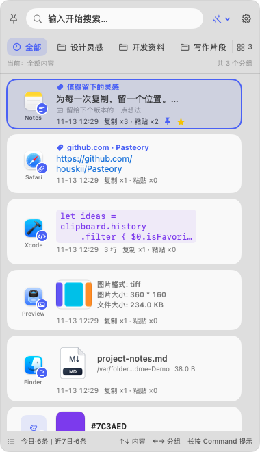
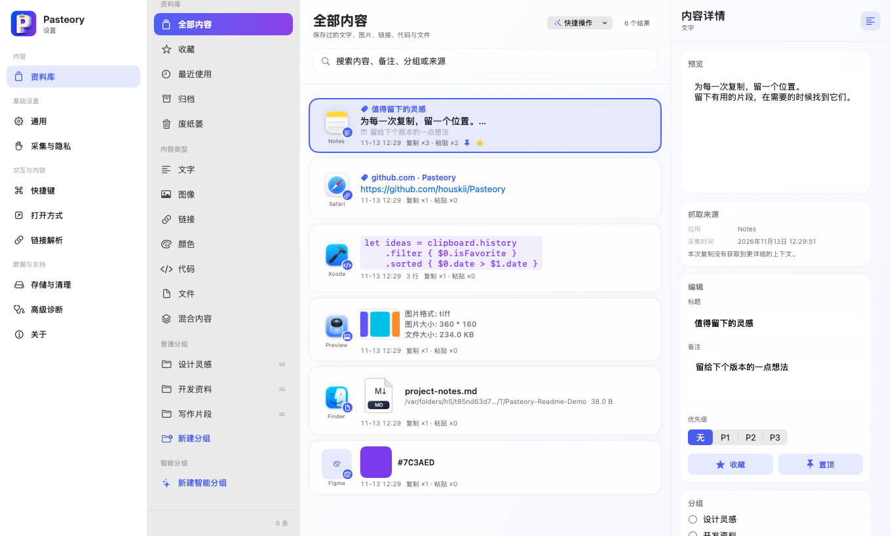

# Pasteory

[English](README.md) | **简体中文**

**从复制过的内容里，学会你做事的习惯。**

Pasteory 是一个本地优先的 macOS 剪贴板管理工具。文字、图片、链接、代码、颜色和文件引用随手保存，需要时找回、粘贴，继续手上的工作。

[下载最新 Beta](https://github.com/houskii/Pasteory/releases) · [全部版本](https://github.com/houskii/Pasteory/releases)

## 一个快捷键，找回刚才的内容

按 **⌘⇧V** 打开快捷面板，搜索历史、切换分组，把之前复制过的内容粘贴到当前应用。

- **随时找回。** 按内容、标题、备注、分组或来源应用搜索。
- **留下有用的片段。** 收藏、置顶、分组，或把相关内容聚合在一起；智能分组按规则自动收集内容。
- **按自己的方式粘贴。** 保留原格式或使用纯文本，也可以用指定应用打开链接、代码和文件。
- **适合你的习惯。** 自选主题色、分组布局和快捷键；界面支持 English / 简体中文，首次启动默认英文。
- **更新由你确认。** 查看更新内容后，再决定是否下载和安装。

## 留下来的内容，放进资料库

在快捷面板按 **⌘L** 打开资料库，在可调整大小的窗口中浏览内容、添加备注、整理分组。

## 开始使用

需要 **macOS 14 或更高版本**及 **Apple Silicon Mac**。

1. 从 [Releases](https://github.com/houskii/Pasteory/releases) 下载 Beta DMG，打开后将 Pasteory 拖入“应用程序”。
2. 启动 Pasteory。应用会留在菜单栏，开始记录之后新复制的内容。
3. 复制一段内容，按 **⌘⇧V** 打开快捷面板。用 **↑↓** 选择，**⌘F** 搜索，**Return** 粘贴；**⌘C** 只复制。
4. 按提示允许辅助功能权限，即可直接粘贴到其他应用；也可以先复制，再手动粘贴。

**⌥Return** 使用纯文本粘贴。**空格**打开所选内容；请先在“设置 → 打开方式”中选择浏览器、代码编辑器和文件操作。

此 Beta 使用本地开发代码签名，尚未经过 Apple 公证。如果 macOS 阻止首次启动，可在“系统设置 → 隐私与安全性”中核对应用后选择“仍要打开”。

如果 DMG 中附有 `Allow Pasteory.command`，也可按包内 `Read Me First.txt` 的说明运行辅助脚本。它会先核对已安装应用，经你确认后，仅移除此 Pasteory 副本的下载隔离标记。

首次启动为英文界面。在 **Settings → General → Interface Language** 选择 **简体中文**，即可切换中文；之后也可在“设置 → 通用 → 界面语言”中切换。

## 隐私默认留在本机

剪贴板历史保存在这台 Mac，不包含云同步或 AI 分析。默认忽略密码应用及隐藏、临时剪贴板内容，也可在设置中排除其他应用。

可选的网页标题解析会访问对应网站。Chrome、飞书、微信的来源详情采集默认关闭，由你开启。更新检查仅访问 GitHub，不发送剪贴板内容，可在“设置 → 关于”中关闭。

直接复制的图片会保存到本机；复制文件时只保存引用，原文件仍在原处。设置中提供本地备份、归档、历史清理和废纸篓。

## 参与改进

欢迎通过 [Issues](https://github.com/houskii/Pasteory/issues) 反馈问题和建议。源码构建说明见[开发指南](docs/DEVELOPMENT.md)。
