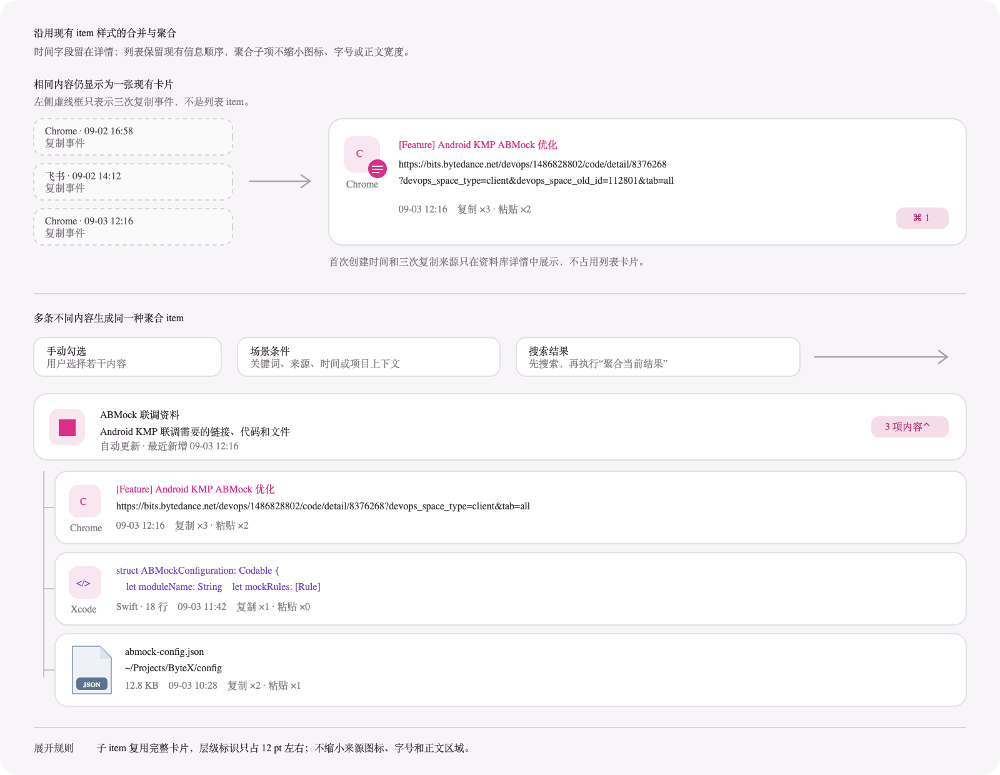

# Pasteory 内容合并与聚合设计

Pasteory 需要把两件事分开处理：相同内容只保留一个内容 item，多条不同内容才能组成聚合 item。场景判断、搜索结果和手动勾选只是选出聚合成员的方法，不会生成不同类型的聚合 item。

## 三层数据

| 数据 | 含义 | 是否单独显示在列表 |
| --- | --- | --- |
| 复制事件 | 某次复制发生的时间、来源 App 和抓取上下文 | 否，在内容详情的“复制来源”中查看 |
| 内容 item | 现有列表中的普通内容卡片，可以打开、复制、粘贴和编辑 | 是 |
| 聚合 item | 多条不同内容组成的一组内容 | 是，可展开为聚合子 item |

同一份内容可以有很多次复制事件，但始终只有一个内容 item。文档中的“内容 item”只是数据名称，界面继续使用当前普通卡片，不显示“一个普通内容 item”之类的说明文字。聚合 item 的成员是内容 item，不是复制事件。

## 相同内容直接合并

内容身份第一版使用 `primaryKind + contentHash`。来源 App、复制时间、自动解析标题和用户填写的标题、备注都不参与相同内容判断。这个判断必须保持保守：只有内容和可执行表示完全一致时才合并，正文中提到同一个链接不算相同内容。

再次捕获到相同内容时，继续使用已有内容 item 的 ID：

- `copyCount` 增加 1。
- `lastCopiedAt` 和 `updatedAt` 更新为本次复制时间。
- `createdAt` 保留第一次捕获时间，默认不在列表展示。
- 每次都新增一条 `ClipCaptureEvent`，保存本次来源 App、复制时间和抓取上下文。
- 主卡片的来源可以显示最近一次复制来源，全部来源记录放在资料库详情中。
- 用户填写的标题、备注、收藏、置顶和分组不被新捕获的数据覆盖。
- 自动标题、预览和分类结果只在新结果质量更高或旧字段缺失时更新。

通过 Pasteory 执行粘贴时只增加 `pasteCount` 并更新 `updatedAt`。它不修改 `copyCount` 和 `lastCopiedAt`，所以粘贴不会把内容移到最近复制列表的顶部。如果以后要展示最近粘贴时间，应增加独立的 `lastPastedAt`，不要借用 `lastCopiedAt`。

这一步属于内容合并，不产生父 item、聚合子 item、`x 条记录` 入口或代表内容箭头。重复复制的来源和时间在详情页查看。

## 聚合 item 只有一种

聚合 item 用来装多条不同的内容。它包含自己的标题、备注、创建时间、更新时间、收藏和置顶状态，以及一组去重后的内容 item ID。

| 选出成员的方法 | 示例 | 生成后的结果 |
| --- | --- | --- |
| 手动勾选 | 用户选择若干链接、代码和文件 | 一个普通聚合 item |
| 场景条件 | 项目名称、来源上下文、时间范围或搜索关键词命中 | 同一种聚合 item |
| 搜索结果 | 用户搜索 `abmock` 后选择“聚合当前结果” | 同一种聚合 item |

场景条件可以使用搜索关键词，也可以使用来源、时间、应用、项目实体等信号。搜索结果聚合指的是先完成搜索，再把当前结果保存成一个聚合 item；搜索过程本身不创建聚合。

生成方式只作为来源信息保存，例如“手动创建”“由场景条件生成”“来自搜索：abmock”。它用于解释成员从哪里来、以后是否可以重新计算，不改变聚合 item 的卡片结构和交互。

## 固定成员和自动更新

聚合 item 可以有两种成员维护方式，但 UI 仍然相同：

- 固定成员：保存创建时的内容 item ID。手动选择和“聚合当前搜索结果”默认使用这种方式。
- 自动更新：保存判断条件，并在新内容进入时重新计算成员。自动场景判断可以使用这种方式。

用户可以把自动更新的聚合改为固定成员。手动移除的成员需要加入排除列表，避免下一次计算时立即被加回来。普通搜索的动态结果仍由智能分组负责，不要把“保存搜索条件”和“聚合当前结果”混成同一个操作。

## 卡片和交互

聚合父 item 展示聚合自己的标题、备注和成员数量，不采用某个子 item 作为代表，也不显示弱蓝色箭头。创建时间、最近更新时间和生成条件放在资料库详情中，不占用快捷面板卡片。

父 item 支持：

- 展开、收起和编辑聚合信息。
- 收藏、置顶、设置分组和删除聚合。
- “整理全部成员”“收藏全部成员”等写明作用范围的批量操作。
- 查看生成方式和自动更新条件。

父 item 不直接打开、复制或粘贴某个成员。`Space`、`Return` 或双击作用于父 item 时，只展开并选择上次选中的子 item；没有历史选择时选中第一个子 item。聚合父 item 不分配 `⌘1～⌘9` 编号。

聚合子 item 就是普通内容卡片在聚合中的引用，完整保留来源图标、类型图标、标题、正文、备注、时间和操作。它只增加不超过 `16 pt` 的层级留白。左侧使用一条连续的主题色主线表达聚合范围，并在每张子卡片垂直居中的位置显示一个 `2 × 15 pt` 的加深标记；主线右侧与子卡片之间保留约 `9 pt`。相邻行的主线必须首尾精确衔接，不能重叠产生额外的假标记。最后一项的主线延伸到卡片底部，但不进入下一段空白间距，使每个子 item 内部的线长保持一致。卡片宽度至少保留列表可用宽度的 `95%`，不能缩成只显示几个字的摘要条。删除一个聚合子 item 默认只把它移出当前聚合，不删除资料库中的原内容；“移到废纸篓”必须作为另一个明确动作提供。

聚合收起时记录 `lastSelectedChildID`。再次展开后恢复到同一个子 item；如果该成员已被移除，再选择第一个可见成员。

### 创建聚合的入口

“聚合内容”的默认快捷键为 `⌘B`，设置页允许修改或关闭。它在不同状态下复用同一个动作：搜索中聚合当前结果，多选时聚合所选内容，普通单选时进入多选，选中聚合父 item 时编辑成员。

搜索结果数量右侧显示靠右排列的“聚合结果”按钮。点击按钮或按 `⌘B` 都先打开确认层，显示去重后的最终成员数量、默认标题和生成来源，不直接保存。搜索框有焦点时，包含 Command 的聚合快捷键仍然生效。

确认层按 `Return` 创建，按 `Esc` 返回原搜索结果。创建成功后退出搜索并选中新聚合，聚合默认收起；底部提示“已聚合 x 项内容”，并提供一次撤销入口。

普通列表支持 `Command` 点击切换选择、`Shift` 点击连续选择。进入多选后，方向键移动当前项，`Space` 勾选，`Return` 或 `⌘B` 打开确认层，`Esc` 退出多选。

## 搜索时怎么显示

普通搜索先返回内容 item，相同内容不会因为复制过多次而重复出现。聚合 item 的标题、备注或成员命中搜索时，搜索结果保留父子关系：

- 命中聚合标题或备注时显示父 item。
- 只命中部分成员时显示父 item，并展开命中的子 item，父 item 显示 `匹配 x / y`。
- 用户点击“聚合当前结果”后，把当前搜索结果中的不同内容 item 去重，再创建一个固定成员的聚合 item。

搜索结果中如果包含已有聚合，创建确认层把它展开成内容成员并再次去重。Pasteory 不保存聚合套聚合的列表结构。最终少于两项不同内容时不能创建聚合。

## 建议的数据模型

现有 `Clip` 可以继续作为内容 item，补强全局内容合并逻辑。聚合对象建议至少保存：

- `aggregationID`：稳定标识。
- `title` 和 `note`：聚合自己的信息。
- `memberClipIDs`：去重后的内容 item ID。
- `membershipMode`：固定成员或自动更新。
- `origin`：手动、场景条件或搜索结果。
- `condition`：自动更新时使用的判断条件。
- `excludedClipIDs`：用户从自动聚合中手动移除的内容。
- `createdAt` 和 `updatedAt`：聚合自身的时间。

数据层不允许同一个内容 item 在同一聚合中出现两次。一个内容 item 可以同时属于多个聚合，因为聚合关系只保存引用，不复制或移动原内容。

## 实施顺序

先把跨时间、跨来源 App 的相同内容合并成一个 `Clip`，并迁移现有重复数据。确认搜索 `abmock` 只返回一个普通链接 item 后，再实现统一的聚合 item 和三种成员选择入口。这样可以先解决重复结果，也不会把临时的相同内容父子结构写进正式数据模型。
