# Pasteory 文件图标系统设计稿

这份文档记录文件图标的视觉方向、后缀映射和回退规则。49 个图标已经栅格化为 `128 × 128` PNG，并接入快捷面板、资料库和正式构建。

## 设计预览

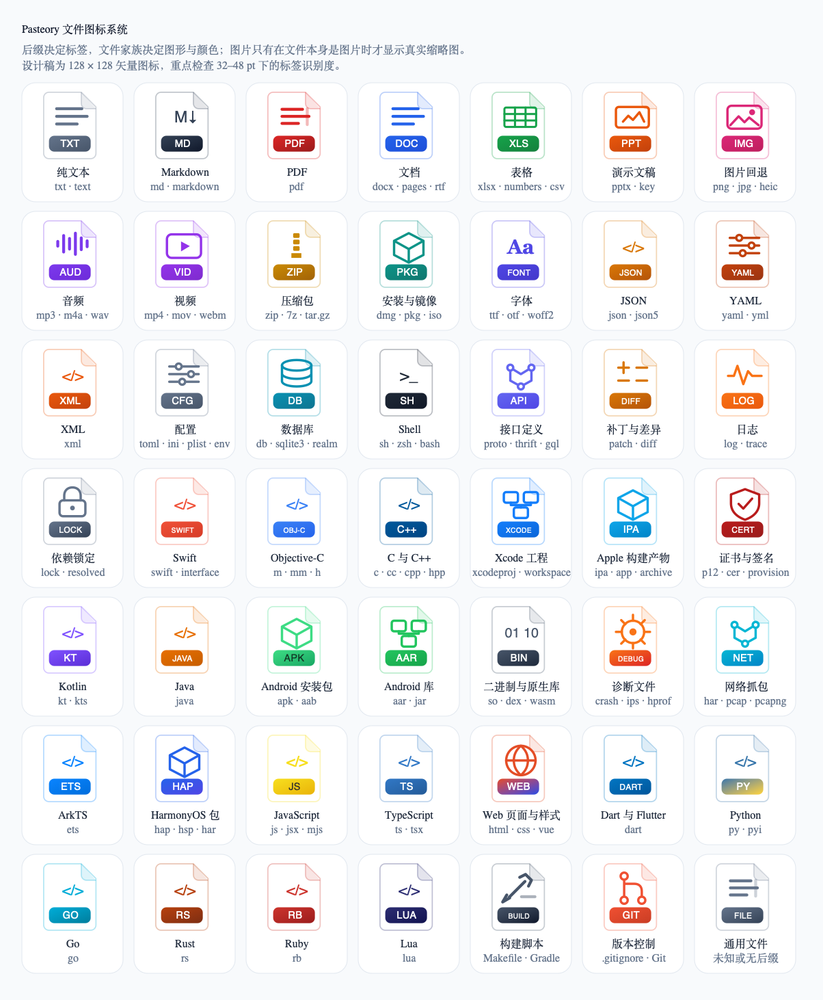

小尺寸与深色背景检查：

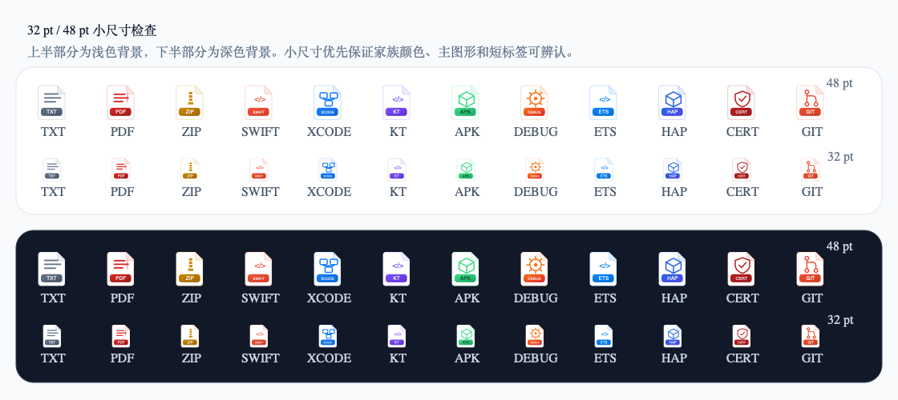

本轮生成了 49 个 `128 × 128` SVG 图标。每个图标使用相同的文件轮廓，文件家族决定主图形和颜色，后缀或文件类型显示在底部标签中。

48 pt 下可以同时辨认图形、颜色和标签。32 pt 下优先依靠图形与颜色区分文件家族，长标签只作为辅助信息；文件名仍负责展示完整后缀。如果产品要求 32 pt 下也能读清 `SWIFT`、`XCODE` 这类长标签，需要再生成一套紧凑标签，例如 `SW`、`XC`。

## 匹配顺序

图标不能只读取 `pathExtension`。客户端工程里有无后缀文件、复合后缀和同后缀不同含义的情况，建议按以下顺序匹配：

1. 匹配完整文件名，例如 `Makefile`、`Podfile`、`Package.swift`。
2. 匹配复合后缀，例如 `tar.gz`、`perfetto-trace`。
3. 处理有歧义的后缀，例如 `.har`、`.h`，结合 UTI、内容签名和来源应用判断。
4. 匹配普通后缀，例如 `swift`、`kt`、`txt`。
5. 后缀未知时读取文件自身的 UTI。
6. 仍无法识别时使用通用文件图标，标签取不超过 5 个字符的后缀；没有后缀则不显示标签。

从剪贴板拿到 `file:///.file/id=...` 这类文件引用时，URL 本身可能没有可靠后缀，应优先读取已经解析出的文件名。不能用文件图标、预览图等辅助表示反推文件类型。

## 普通文件

| 图标 | 图标资产 | 匹配后缀 | 用途 |
| --- | --- | --- | --- |
|  | `txt` | `txt`、`text` | 纯文本 |
|  | `markdown` | `md`、`markdown` | Markdown |
|  | `pdf` | `pdf` | PDF 文档 |
|  | `document` | `doc`、`docx`、`pages`、`rtf`、`epub` | 普通文档 |
|  | `spreadsheet` | `xls`、`xlsx`、`numbers`、`csv`、`tsv` | 表格与结构化数据 |
|  | `presentation` | `ppt`、`pptx`、`key` | 演示文稿 |
|  | `image` | `png`、`jpg`、`jpeg`、`heic`、`heif`、`gif`、`webp`、`svg`、`tif`、`tiff`、`bmp` | 图片缩略图失败时的回退图标 |
|  | `audio` | `mp3`、`m4a`、`wav`、`aac`、`flac`、`ogg` | 音频 |
|  | `video` | `mp4`、`mov`、`m4v`、`mkv`、`webm`、`avi` | 视频 |
|  | `archive` | `zip`、`7z`、`rar`、`tar`、`gz`、`tgz`、`tar.gz`、`bz2`、`xz` | 压缩包 |
| 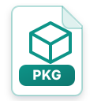 | `installer` | `dmg`、`pkg`、`iso` | 安装包与磁盘镜像 |
|  | `font` | `ttf`、`otf`、`woff`、`woff2` | 字体 |
|  | `generic` | 未知或无后缀 | 通用回退图标 |

## 配置、数据与脚本

| 图标 | 图标资产 | 匹配后缀 | 用途 |
| --- | --- | --- | --- |
| 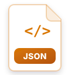 | `json` | `json`、`json5` | JSON 与 JSON5 |
| 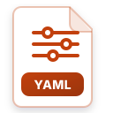 | `yaml` | `yaml`、`yml` | YAML |
|  | `xml` | `xml` | XML |
| 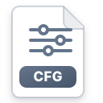 | `config` | `toml`、`ini`、`conf`、`config`、`plist`、`entitlements`、`properties`、`env` | 配置文件 |
| 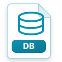 | `database` | `db`、`sqlite`、`sqlite3`、`realm`、`sql` | 数据库与 SQL |
|  | `shell` | `sh`、`bash`、`zsh`、`fish` | Shell 脚本 |
| 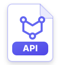 | `api` | `proto`、`thrift`、`graphql`、`gql` | 接口定义 |
|  | `diff` | `patch`、`diff` | 补丁与差异 |
|  | `log` | `log`、`trace` | 日志与普通跟踪文件 |
|  | `lock` | `lock`、`resolved` | 依赖锁定文件 |

## iOS 与 macOS 开发

| 图标 | 图标资产 | 匹配后缀 | 用途 |
| --- | --- | --- | --- |
| 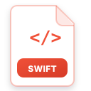 | `swift` | `swift`、`swiftinterface`、`swiftmodule` | Swift 源码与接口 |
| 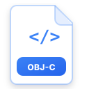 | `objc` | `m`、`mm` | Objective-C 与 Objective-C++ |
| 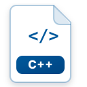 | `cpp` | `c`、`cc`、`cpp`、`cxx`、`h`、`hpp` | C、C++ 与通用头文件 |
|  | `xcode` | `xcodeproj`、`xcworkspace`、`pbxproj`、`xcconfig`、`storyboard`、`xib`、`strings`、`stringsdict` | Xcode 工程与资源 |
|  | `ios-package` | `app`、`ipa`、`xcarchive`、`xcresult`、`dSYM` | Apple 构建与诊断产物 |
|  | `certificate` | `mobileprovision`、`p12`、`pfx`、`cer`、`crt`、`pem`、`key` | 证书、密钥与描述文件 |

`.h` 默认使用 C/C++ 图标。只有在可以确认工程语言或关联的实现文件时，才把它归到 Objective-C，避免单凭 Xcode 来源应用误判。

## Android 开发

| 图标 | 图标资产 | 匹配后缀 | 用途 |
| --- | --- | --- | --- |
| 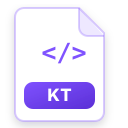 | `kotlin` | `kt`、`kts` | Kotlin 源码与脚本 |
|  | `java` | `java` | Java 源码 |
| 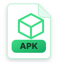 | `android-package` | `apk`、`aab` | Android 安装与发布包 |
|  | `android-library` | `aar`、`jar` | Android 与 JVM 库 |
|  | `binary` | `so`、`dex`、`wasm` | 原生库、字节码与二进制文件 |
|  | `diagnostic` | `crash`、`ips`、`hprof`、`profraw`、`profdata`、`perfetto-trace` | 崩溃、性能与内存文件 |
|  | `network` | HTTP `har`、`pcap`、`pcapng` | 网络抓包文件 |

## HarmonyOS 与跨平台开发

| 图标 | 图标资产 | 匹配后缀 | 用途 |
| --- | --- | --- | --- |
| 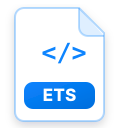 | `arkts` | `ets` | ArkTS 源码 |
| 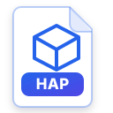 | `harmony-package` | `hap`、`hsp`、Harmony `har` | HarmonyOS 应用与共享包 |
|  | `javascript` | `js`、`jsx`、`mjs`、`cjs` | JavaScript |
| 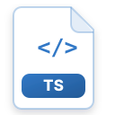 | `typescript` | `ts`、`tsx` | TypeScript |
|  | `web` | `html`、`htm`、`css`、`scss`、`sass`、`less`、`vue`、`svelte` | Web 页面、样式与组件 |
|  | `dart` | `dart` | Dart 与 Flutter |
| 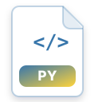 | `python` | `py`、`pyi` | Python 与客户端构建工具脚本 |
|  | `go` | `go` | Go 源码与工具 |
| 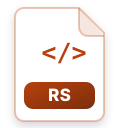 | `rust` | `rs` | Rust 源码与原生组件 |
| 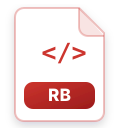 | `ruby` | `rb` | Ruby、CocoaPods 与 Fastlane 脚本 |
|  | `lua` | `lua` | Lua 脚本 |
| 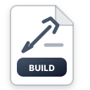 | `build` | 由完整文件名规则匹配 | 构建与依赖脚本 |
|  | `git` | 由完整文件名规则匹配 | Git 配置与忽略规则 |

`.har` 有两种常见含义。ZIP 或 Harmony 包结构使用 `HAP` 家族；以 JSON 保存的 HTTP Archive 使用 `NET` 家族。这里需要读取内容签名，不能只看后缀。

## 特殊文件名

| 完整文件名 | 图标资产 |
| --- | --- |
| `Makefile`、`CMakeLists.txt`、`Dockerfile`、`build.gradle`、`settings.gradle`、`gradlew`、`hvigorfile.ts` | `build` |
| `Podfile`、`Cartfile`、`Gemfile` | `build` |
| `Podfile.lock`、`Package.resolved`、`yarn.lock`、`pnpm-lock.yaml`、`package-lock.json`、`gradle.lockfile` | `lock` |
| `Package.swift` | `swift` |
| `oh-package.json5`、`module.json5` | `config` |
| `.gitignore`、`.gitattributes`、`.gitmodules` | `git` |
| `.env`、`.npmrc`、`.swiftlint.yml`、`.editorconfig` | `config` |

## 图片预览与文件图标的边界

图片缩略图只在文件本身是图片时加载。判定依据是实际文件名、文件 URL 和文件自身的 UTI，剪贴板附带的辅助图片不参与判定。

对于普通文件，以下内容只能当作辅助表示，不能触发图片预览：

- `com.apple.icns` 文件图标。
- Finder 或来源应用附带的 TIFF、PNG 图标。
- Quick Look 预览图。
- 来源应用的图标。

缩略图组件需要区分“加载中”“加载成功”“加载失败”。加载失败后立即回退到本文件图标，不能继续显示转圈动画。`mac_lock_screen.txt` 这类带 ICNS 图标的文本文件，应直接显示 `TXT` 图标和文件名。

## 视觉规则

- 文件轮廓保持一致，折角固定在右上方。
- 上半部分用线性图形表达文件家族，底部色块显示短标签。
- 同一文件家族共用颜色，不为每个后缀单独增加颜色。
- 代码语言可以保留行业内已经形成认知的颜色，例如 Swift 橙、Kotlin 紫、Android 绿。
- 图标不直接复制第三方商标，降低风格漂移和授权风险。
- SVG 使用透明画布，浅色和深色背景共用同一份资产。

## 资产与生成方式

- `file-icons/*.svg`：49 个独立矢量设计源文件。
- `file-icons/catalog.svg`：可编辑的完整总览。
- `file-icons/catalog.png`：用于 Markdown 和快速审阅的总览图。
- `file-icons/size-preview.svg`、`file-icons/size-preview.png`：32 pt、48 pt 与深浅背景检查。
- `../scripts/generate_file_icons.swift`：图标生成脚本。
- `../scripts/generate_file_icon_pngs.sh`：把独立 SVG 栅格化为生产 PNG。
- `../Resources/FileIcons/*.png`：随正式 App 发布的 49 个 `128 × 128` PNG。

重新生成 SVG：

```bash
arch -arm64 /usr/bin/swift scripts/generate_file_icons.swift
xmllint --noout docs/file-icons/*.svg
zsh scripts/generate_file_icon_pngs.sh
```

正式实现由 `FileIconResolver` 负责完整文件名、复合后缀、普通后缀和歧义后缀的匹配。`ClipRowView` 与资料库详情共用同一套图标和文件元数据加载规则。

“设置 → 打开方式 → 文件”复用这套文件图标和后缀目录。选择器按后缀升序排列，每个后缀单独配置，例如 `.swift`、`.swiftinterface` 和 `.swiftmodule` 是三条互不影响的规则；后缀显示在前，文件图标和类型说明用于辅助识别。也可以新增 `.hap`、`.tar.gz` 等自定义后缀，自定义规则优先于同后缀的预设规则。两种规则都可以选择 App，或者通过统一的 bash／zsh 执行自定义命令。命令里的 `$file` 是原文件绝对路径，Pasteory 不把路径直接拼进命令文本。原文件被删除后，列表和详情会标记“已删除”、添加删除线并置灰，同时停止打开和命令执行。

终端窗口通过一次性完成标记判断命令已经返回，再等待 3 秒关闭对应窗口，不依赖 Terminal 的 `busy` 状态。工作目录、`$file`、PATH 和用户命令放在权限受限的一次性脚本中，Terminal 只显示简短的启动命令和实际输出；脚本完成或窗口被关闭后清理。静默模式把该 bash／zsh 文件命令的 stdout 和 stderr 合并写入 `Logs/FileCommands`，不包含 Pasteory App 日志；终端窗口模式不写入这里。单次最多保存 1 MB，目录最多保留最近 20 份，设置页可以实时查看最近一次命令输出。
