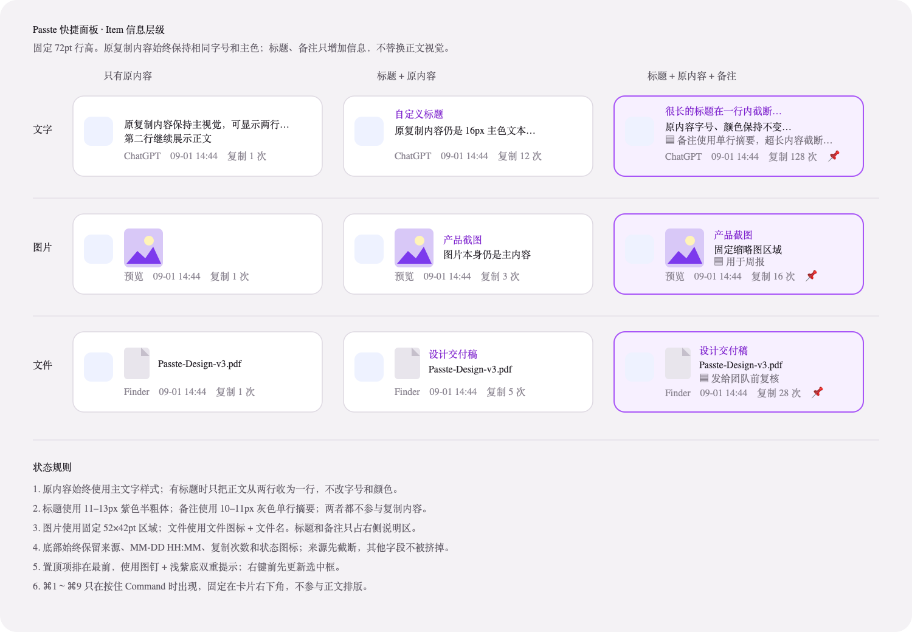

# Pasteory 内容项设计规范

这份文档记录快捷面板和资料库共用的内容项设计。两处界面都使用 `ClipRowView`，信息顺序、状态表达和截断规则必须保持一致；两者的区别只在可用宽度和字号密度。



## 卡片结构

每个内容项从左到右分为来源区、内容区和辅助操作区。内容区底部固定显示复制时间和使用统计。

| 区域 | 内容 | 规则 |
| --- | --- | --- |
| 来源区 | 来源 App 图标、内容类型角标、来源名称 | 图标与角标居中；来源名称单行截断，不参与正文排版 |
| 内容区 | 标题、正文或预览、备注、类型信息 | 原内容始终是主信息；标题和备注只补充信息，不替换原内容 |
| 统计行 | 最近复制时间、项目数、代码行数、复制次数、粘贴次数、置顶与收藏状态 | 保持单行；优先保留时间和次数，较长文本必须先截断 |
| 辅助操作区 | `⌘1～⌘9` | 只在按住 Command 时显示，固定在右下角，不挤压内容区 |

来源区在快捷面板中宽 `54 pt`，资料库中宽 `60 pt`。来源 App 图标分别使用 `38 pt` 和 `46 pt`，内容类型角标直径为 `18 pt`。

## 信息层级

标题使用当前主题色和标签图标，快捷面板字号为 `11 pt`，资料库字号为 `12 pt`。正文使用主文字颜色，普通内容字号分别为 `13 pt` 和 `14 pt`。备注使用次要文字颜色和备注图标，保持单行。

统计行使用系统 Caption 字号，文案统一为 `复制 ×3 · 粘贴 ×2`。复制次数只统计系统剪贴板采集，粘贴次数只统计 Pasteory 已确认发送的粘贴操作。计数达到 1,000 后使用 `K`，提示文本和辅助功能仍保留精确数值。

## 不同内容类型

| 类型 | 快捷面板高度 | 资料库高度 | 主要内容 |
| --- | ---: | ---: | --- |
| 文字、颜色、混合内容 | `72 pt` | `82 pt` | 文字摘要、真实色块或混合内容摘要 |
| 链接 | `86 pt` | `92 pt` | 解析标题、URL 和链接状态 |
| 代码 | `96 pt` | `104 pt` | 等宽代码摘要、语言和行数 |
| 文件 | `96 pt` | `104 pt` | 后缀图标、文件名、父目录和文件大小 |
| 图片 | 最低 `88 pt` | 最低 `96 pt` | 缩略图、图片格式、像素尺寸和文件大小 |

图片存在标题或备注时，卡片按实际内容增加高度，不允许用固定高度裁掉元数据。图片信息固定分三行：

```text
图片格式: png
图片大小: 123 * 1234
文件大小: 78.0 KB
```

像素尺寸来自图片数据，不能使用界面中的缩放尺寸。文件大小使用十进制 `B / KB / MB / GB`，固定保留一位小数。

直接从网页、聊天、截图工具或图片编辑器复制出来的图片数据，会按内容哈希保存到 Pasteory 的 `Attachments`。之后即使来源页面关闭，或来源应用中的原图被删除，Pasteory 中的图片仍可预览、复制和打开。只有 Pasteory 自己的应用数据或附件被删除、损坏时，这份副本才会不可用；导出备份时附件会一起导出。

从 Finder 复制 `.png`、`.jpeg` 等图片文件时，它仍属于文件引用。Pasteory 不主动复制文件实体；原文件被移动或删除后，记录继续保留，但原图内容无法恢复。来源应用若同时向剪贴板提供了完整图片数据，则该图片数据仍按上一条规则保存；文件图标或缩略图不能视为完整原图副本。

文件项显示文件名、父目录和文件大小。父目录不得重复文件名；文件图标按完整文件名、复合后缀、普通后缀和 UTI 的顺序匹配。图片文件可以显示缩略图，但来源 App 附带的 ICNS、TIFF、PNG 图标不能被误认为文件内容。

代码项最多展示三行摘要，优先从声明或有效语句开始。列表只做轻量样式，完整内容在详情区按需读取。

颜色项必须显示真实色块和原始颜色值。色块使用描边保证浅色内容在浅色背景下仍能看清。

## 状态

- 普通卡片使用系统动态背景和弱描边。
- 当前选中项使用主题色描边。
- 置顶项使用主题色浅背景；置顶、收藏和优先级继续显示在统计行。
- 缩略图加载失败后显示对应类型的回退图标，不持续显示加载动画。
- 深色模式沿用系统动态颜色；主题色只用于选中态、标题和类型角标。

## 截断与性能

正文、标题、备注、来源名称和路径各自负责截断，不能依靠整个卡片裁剪。时间、复制次数、粘贴次数和快捷键使用固定尺寸并提高布局优先级。

多文件剪贴板作为一条内容保存。卡片左侧叠放最多三个实际文件类型图标并显示总数，正文显示“x 个文件”和前三个文件名；详情中逐项显示全部文件。不能只用首个文件名、首个图标和首个文件元数据代表整条内容。

图片缩略图、图片元数据和文件图标都使用缓存。列表滚动时不能重复读取或解码已经加载的资源，也不能因为鼠标经过某一项而刷新整列。

## 相同内容直接合并

完全相同的内容始终使用同一个普通 item。这里的普通 item 就是 Pasteory 当前已经在列表中展示的内容卡片，不增加新的样式或“普通内容 item”标签。再次复制时增加复制次数，更新最近复制时间，并把来源和时间追加到复制事件中；列表不生成聚合父项、子项、`x 条记录` 入口或代表内容箭头。具体规则见 [相同内容合并设计](LINK_AGGREGATION_DESIGN.md)。

## 三种 item

普通 item、聚合 item 和聚合子 item 现在共用这套规范；后续新增场景条件时继续复用同一种聚合数据与卡片，不再增加第四种列表 item。

聚合 item 只用于组织多条不同内容。手动勾选、场景条件和当前搜索结果只是选出成员的不同方法，生成后使用同一种 UI 和交互。完整规则见 [内容合并与聚合设计](AGGREGATION_SYSTEM.md)。

| 类型 | UI 样式 | 展示逻辑 |
| --- | --- | --- |
| 普通 item | 使用标准内容卡片，不显示展开入口 | 一条数据库内容对应一张卡片，来源、标题、正文、备注和统计都来自该记录 |
| 聚合 item | 使用独立的聚合卡片，在右侧显示 `x 项内容` 和展开符号 | 展示聚合自己的标题、备注、生成方式和成员数量，不采用某个成员作为代表内容 |
| 聚合子 item | 完整复用普通 item 卡片，只增加 `16 pt` 的层级留白；连续主线上按卡片中心显示轻微加深的短标记 | 保留来源图标、类型图标、标题、正文、备注、时间、使用次数和状态；不改成摘要条 |

`x 项内容` 统计去重后的成员数量。每个聚合子 item 自己显示复制和粘贴次数；父 item 不把这些次数求和后伪装成自身的使用次数。

聚合 item 展开后，父 item 保持原位置，子 item 插入到父 item 下方。左侧保留一条连续的主题色主线，每张子卡片在垂直中心位置显示一个 `2 × 15 pt` 的加深标记，用来识别并清点成员。主线右侧与子卡片之间保留约 `9 pt`，避免关系标记贴住卡片。相邻行的主线必须首尾精确衔接，不能靠线段重叠填补间距，否则叠色会产生额外的假标记。最后一项的主线延伸到卡片底部，但不再进入下一段空白间距，使每个子 item 内部的线长保持一致。关系标识总宽度不超过 `16 pt`，子卡片宽度至少保留列表可用宽度的 `95%`。收起后立即恢复普通列表密度。子 item 不显示 `⌘1～⌘9` 编号，也不计入顶层编号顺序。

## 选择与鼠标交互

| 操作 | 普通 item | 聚合 item | 聚合子 item |
| --- | --- | --- | --- |
| 单击卡片 | 选择 | 选择父 item | 选择该子 item |
| 双击卡片 | 直接粘贴 | 展开并选择上次选中的子 item；没有历史选择时选择第一个 | 粘贴该子 item |
| 点击数量入口 | 无 | 展开或收起 | 无 |
| 空格打开 | 打开当前 item | 展开并选择上次选中的子 item，不直接打开成员 | 打开该子 item |
| 编辑信息 | 编辑当前 item | 编辑聚合自己的标题、备注、规则或条件 | 编辑该子 item |
| 收藏、置顶、设置分组 | 作用于当前 item | 作用于聚合自身；批量修改成员需要选择写明“全部成员”的动作 | 只作用于该子 item |
| 删除 | 移到废纸篓 | 删除聚合关系，保留成员内容 | 默认只移出当前聚合；“移到废纸篓”作为另一个明确动作 |

## 快捷面板键盘交互

普通内容的标题、备注和普通分组在同一个编辑弹窗中处理。`⌘E` 从标题开始，`⌘G` 直接进入分组区；`Tab / Shift-Tab` 在标题、备注和分组之间循环，分组区使用 `↑ / ↓` 选择、`Space` 勾选。`Return` 一次保存全部修改，`Esc` 放弃本次草稿。

| 快捷键 | 普通 item | 聚合 item | 聚合子 item |
| --- | --- | --- | --- |
| `↑ / ↓` | 在可见 item 之间移动 | 选中父项；展开后继续进入子项 | 在相邻子项和顶层 item 之间移动 |
| `← / →` | 循环切换顶部分组 | 仍然循环切换顶部分组，不用于展开 | 仍然循环切换顶部分组 |
| `⌘↓` | 无操作 | 展开；已经展开时把选择移到第一个子 item | 无操作 |
| `⌘↑` | 无操作 | 收起 | 返回父 item 并收起聚合 |
| `Space` | 按设置打开 | 展开并选择上次选中的子 item，不直接打开成员 | 打开该子 item |
| `Return` | 直接粘贴 | 展开并选择上次选中的子 item，不直接粘贴成员 | 粘贴该子 item |
| `⌘C` | 只复制 | 展开并选择上次选中的子 item，不直接复制成员 | 复制该子 item |
| `⌥Return` | 纯文本粘贴 | 展开并选择上次选中的子 item，不执行内容动作 | 对该子 item 执行 |
| `⌘⌥C` | 纯文本复制 | 展开并选择上次选中的子 item，不执行内容动作 | 对该子 item 执行 |
| `⌘1～⌘9` | 粘贴对应顶层 item | 不分配编号 | 不分配编号 |
| `⌘B` | 搜索中聚合当前结果；普通单选时进入多选 | 打开聚合成员编辑 | 普通单选时进入多选并勾选该内容；多选时聚合所选内容 |
| `Esc` | 有聚合确认层时先取消，处于多选时先退出，否则关闭快捷面板 | 有成员编辑层时先关闭，否则关闭快捷面板 | 多选时先退出，否则关闭快捷面板 |

`⌘↓` 和 `⌘↑` 是“展开聚合”和“收起聚合”的默认快捷键，需要作为两个可配置动作加入设置页，并显示在长按 Command 的快捷操作帮助中。升级时如果用户已有动作占用了这两个组合键，保留用户配置，把发生冲突的新动作设为未配置，不得静默覆盖。搜索框有焦点时，已经配置的聚合快捷键仍然生效；不带 Command 的普通字符继续输入搜索词。

“聚合内容”的默认快捷键为 `⌘B`。搜索词不为空且没有多选时，它作用于当前搜索结果；已经多选时只作用于所选内容。普通单选状态第一次触发时进入多选，不直接创建只有一个成员的聚合。快捷键升级时不能覆盖用户已有配置。

聚合父 item 的右键菜单提供展开、收起、编辑聚合、查看生成方式、整理全部成员、收藏全部成员、置顶全部成员，以及“删除聚合但保留内容”。父 item 不提供直接打开、复制或粘贴。所有批量动作都必须写明“全部成员”，不能让用户猜它作用于聚合自身还是其中的内容。

聚合子 item 复用普通 item 的交互，可以单独打开、复制、粘贴、编辑信息、收藏、置顶、设置分组或移到废纸篓。子 item 中不直接展示标题和备注正文，但只要存在手动标题或备注，就在统计行显示一个铅笔图标；收藏、置顶和分组分别使用星标、图钉和文件夹图标，鼠标停留时显示具体状态。

聚合父 item 拥有独立的标题、备注、收藏、置顶和分组状态。成员状态不自动提升到父 item；需要批量修改成员时使用写明“全部成员”的操作。快捷面板中的父 item 默认只显示聚合标题、`x 项内容` 和必要状态，不汇总成员的复制或粘贴次数。

“整理全部成员…”打开批量整理面板，可以把全部子 item 加入或移出普通分组，也可以统一收藏、置顶或归档。批量编辑标题和备注不放进第一版，避免覆盖成员已有内容。

## 资料库交互

资料库单击 `x 项内容` 后在当前卡片下方展开子 item，不打开新的弹窗。选择聚合父 item 时，右侧详情显示聚合自己的标题、备注、成员数量、生成方式和自动更新条件；选择聚合子 item 时，右侧详情切换到对应内容。

列表拥有键盘焦点时，`↑ / ↓` 按可见顺序选择父 item 和子 item，`⌘↓` 展开，`⌘↑` 收起。`Return` 和 `Space` 作用于父 item 时只展开并恢复上次选择，不直接执行某个成员；作用于子 item 时保持原有粘贴和打开行为。

### 资料库中的聚合子 item

聚合子 item 直接显示在父 item 下方，不进入右侧详情后再套一层列表。子 item 完整复用普通卡片：左侧保留正常尺寸的来源 App 图标和类型角标，中间继续按照内容类型展示标题、正文、备注或预览，底部显示复制时间、复制次数、粘贴次数和状态图标。层级关系不能通过缩小图标、字号或正文区域来表达。

父项与子项用轻微缩进和连续主线表达整体范围，并在每张子卡片的中心位置轻微加深主线作为计数标记。标记不能显示成独立色块，也不能比选中描边更醒目。聚合没有代表内容，因此不显示代表箭头；用户实际选中的 item 使用主题色描边。

### 搜索时保留父子关系

搜索结果不能只显示一个失去上下文的聚合子 item：

- 搜索词命中聚合自己的标题或备注时，只显示聚合父 item，不自动展开。
- 搜索词只命中某个子 item 的来源、手动标题或备注时，显示聚合父 item，并在下方自动展开命中的子 item；父 item 显示 `匹配 1 / 3`。
- 搜索态只显示命中的子 item，其余内容收进“另有 2 项内容”，避免一次展开整个聚合。
- 命中标题或备注时，子 item 可以增加一行临时搜索摘要，说明命中位置；退出搜索后这行摘要消失，不变成常驻的标题或备注详情。

### 展开与收起时的选择

聚合需要分别保存 `selectedNodeID` 和 `lastSelectedChildID`：

- `selectedNodeID` 是用户当前用键盘或鼠标选择的父 item 或子 item，使用主题色描边。
- `lastSelectedChildID` 记录当前聚合中最后一次选中的子 item。

如果展开后选中了第 n 个子 item，再收起聚合，隐藏的子 item 不能继续保持列表选择，所以 `selectedNodeID` 回到聚合父 item，同时保存第 n 个子 item 为 `lastSelectedChildID`。同一页面中再次展开时，恢复第 n 个子 item 的选择并滚动到可见位置。

如果第 n 个子 item 已被删除、移出当前筛选或不再属于该聚合，重新展开时选择时间最早的可见子 item。关闭快捷面板、切换资料范围或重新进入资料库后，聚合默认收起并选择父 item，不跨页面会话恢复子项选择。

## 实现位置

- `Sources/Pasteory/ClipViews.swift`：卡片结构、不同类型的内容布局和行高。
- `Sources/Pasteory/FilePresentation.swift`：文件与图片元数据、图片尺寸和文件大小。
- `Sources/Pasteory/QuickPanelView.swift`：快捷面板卡片容器、选择与快捷操作。
- `Sources/Pasteory/LibraryView.swift`：资料库卡片容器、筛选与详情联动。
