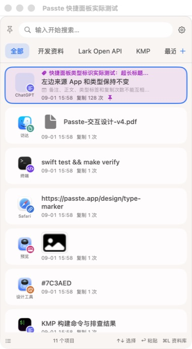
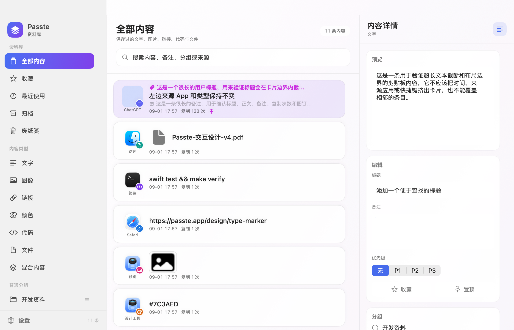

# 资料库页面设计与实现

资料库页面已经从系统 `List` 拼装界面改为 Passte 自己的三栏布局。视觉样式沿用快捷面板已经落地的圆角卡片、轻材质背景和蓝紫强调色，搜索、筛选、分组管理、双击粘贴和详情编辑能力保持不变。

## 设计基准

仓库内的快捷面板实际截图是这次改造的视觉基准：



资料库改造后的实际运行截图：



两处界面共用以下视觉规则：

- 内容承载在圆角卡片中，普通内容使用浅色背景，置顶内容使用淡紫色背景。
- 当前选中项使用蓝色描边；导航选中态使用蓝紫渐变和白色文字。
- 搜索框使用圆角浅色底和弱分隔线，避免系统文本框的凸起边框。
- 来源应用图标、内容类型角标、标题、正文摘要和复制信息继续复用 `ClipRowView`，保证快捷面板和资料库的信息顺序一致。
- 卡片、输入框和分隔线使用系统动态颜色，深色模式下会随系统主题变化。

## 页面结构

资料库窗口最小尺寸为 `900 × 600`。主界面在宽度达到 `1050` 时显示完整三栏，较窄时隐藏右侧详情栏，给内容列表留出足够空间。

| 区域 | 固定尺寸 | 承载内容 |
| --- | ---: | --- |
| 左侧导航 | 232 pt | 资料范围、内容类型、普通分组、智能分组和设置入口 |
| 中间内容区 | 最小 430 pt | 当前范围说明、结果数量、搜索框、内容卡片和空状态 |
| 右侧详情 | 336 pt | 预览、标题与备注、优先级、收藏与置顶、分组和元数据 |

左侧导航使用自定义按钮和选中态，不再依赖 `List`、`Section` 的系统外观。普通分组与智能分组仍支持拖动排序和右键编辑；新建入口放在对应分组的末尾。

中间内容区使用 `ScrollView` 与 `LazyVStack` 展示内容卡片。卡片保留单击选择、双击粘贴和右键菜单。搜索会在当前资料范围内执行，并在标题下方显示搜索上下文。

右侧详情把长表单拆成独立卡片。编辑内容仍通过 `AppState` 的原有方法保存，数据结构和持久化逻辑没有变化。预览区继续使用 `RepresentationPreview`，图片、颜色、代码、文件和文本的展示能力保持不变。

## 状态与交互映射

| 用户操作 | 页面反馈 | 数据行为 |
| --- | --- | --- |
| 选择资料范围或内容类型 | 左侧出现蓝紫选中态，中间标题与说明同步变化 | 更新 `libraryFilter` 后重新查询资料库 |
| 输入搜索词 | 搜索框显示清除按钮，标题下方显示当前搜索范围 | 180 ms 防抖后调用 `refreshLibrary` |
| 单击内容卡片 | 卡片显示蓝色描边，右侧切换到对应详情 | 更新 `selectedClipID` |
| 双击内容卡片 | 保持卡片选择态 | 触发直接粘贴 |
| 修改标题、正文、备注或优先级 | 右侧卡片内即时显示新值 | 复用 `mutateSelected` 或 `updateManualText` 保存 |
| 切换收藏、置顶或普通分组 | 按钮或分组勾选态立即变化 | 复用现有 `AppState` 更新和刷新逻辑 |
| 删除资料 | 当前筛选结果立即刷新 | 移入废纸篓；废纸篓内仍可恢复或彻底删除 |

## 代码位置

- `Sources/Passte/LibraryView.swift`：资料库三栏布局、页面组件、设计颜色和交互绑定。
- `Sources/Passte/ClipViews.swift`：快捷面板与资料库共用的内容行、来源应用图标、类型角标和预览组件。
- `Sources/Passte/AppState.swift`：搜索、筛选、选中项和资料编辑状态。
- `Sources/Passte/AppCoordinator.swift`：资料库窗口和调试截图入口。

`LibraryTheme` 集中保存资料库页面使用的强调色、渐变、卡片背景、输入框背景和分隔线颜色。后续调整品牌色时，应先修改这里，再检查快捷面板是否需要同步。

## 验证方式

核心测试：

```bash
arch -arm64 /usr/bin/swift test --arch arm64
```

生成带隔离数据的资料库验收截图：

```bash
QA_DATA_ROOT=$(mktemp -d /tmp/passte-library-qa.XXXXXX)
arch -arm64 /usr/bin/swift build --arch arm64
.build/arm64-apple-macosx/debug/Passte \
  --debug-data-root "$QA_DATA_ROOT" \
  --debug-open-library \
  --debug-seed \
  --debug-ui-qa \
  --debug-disable-monitor \
  --debug-disable-hotkey \
  --debug-snapshot-path "$PWD/docs/actual-library-redesign.png"
```

调试参数只在 `DEBUG` 构建中生效。截图使用临时数据目录，不读取用户的真实剪贴板资料。

本次验证结果：项目构建通过，12 个核心测试通过；`2240 × 1440` 实际截图已检查三栏比例、长文本截断、置顶卡片、图片与文件预览、编辑控件和滚动边界。
