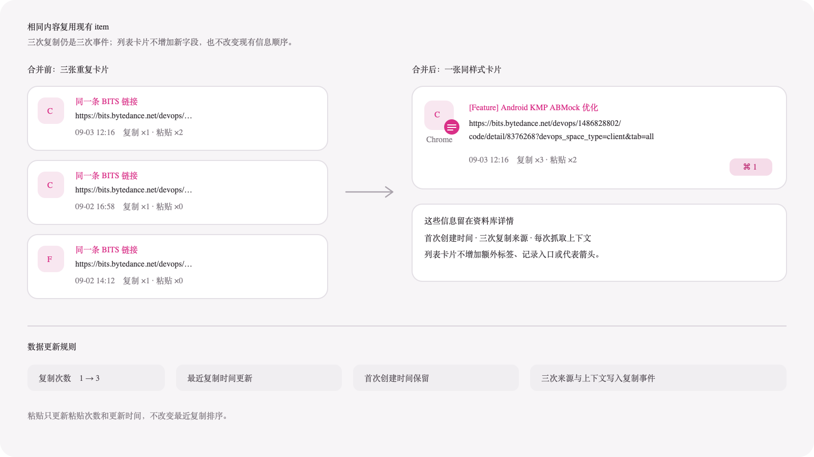

# 相同内容合并设计

本文描述内容身份一致时如何复用同一个内容 item。多条不同内容如何组成聚合 item，见 [Pasteory 内容合并与聚合设计](AGGREGATION_SYSTEM.md)。

## 现状

搜索 `abmock` 时出现的三条 BITS 链接，数据库中的 URL、`content_hash` 和自动解析标题完全一致：

| 最近复制时间 | 来源 | 复制次数 | 粘贴次数 | 手动标题 | 备注 |
| --- | --- | ---: | ---: | --- | --- |
| 09-03 12:16 | Google Chrome | 1 | 2 | 无 | 无 |
| 09-02 16:58 | Google Chrome | 1 | 0 | 无 | 无 |
| 09-02 14:12 | 飞书 | 1 | 0 | 无 | 无 |

现有 `saveCaptured` 只有在两次捕获相距不超过 60 秒、来源 App 相同，并且新内容恰好是当前最新记录时才复用旧 `Clip`。跨天或跨 App 复制同一条链接会生成多个内容 item，所以搜索结果出现三张相同卡片。

## 目标结果

这三条链接合并为一个现有样式的普通 item，不生成聚合父项和子项：

- `createdAt` 取 09-02 14:12，记录第一次出现的时间。
- `lastCopiedAt` 取 09-03 12:16，用于最近复制排序。
- `copyCount` 合计为 3。
- `pasteCount` 合计为 2。
- 三次复制分别保存在 `ClipCaptureEvent`，详情页仍然能看到两个 Chrome 来源和一个飞书来源。
- 列表不显示 `3 条记录`、展开入口或代表内容箭头。

## 新内容的保存规则

使用 `primaryKind + identityKey` 查找已有的有效内容 item，不再限制时间、来源 App 或是否恰好是列表最新记录。`contentHash` 仍保存全部剪贴板表示的完整哈希，不参与内容合并。

找到相同内容时复用已有 ID，并执行以下更新：

| 字段 | 规则 |
| --- | --- |
| `createdAt` | 保持第一次捕获时间 |
| `updatedAt` | 更新为本次保存时间 |
| `lastCopiedAt` | 更新为本次复制时间 |
| `copyCount` | 增加 1 |
| `pasteCount` | 不变 |
| `source` | 更新为最近一次复制来源，历史来源保存在事件表 |
| 手动标题、备注 | 保留已有内容，不被新捕获覆盖 |
| 收藏、置顶、普通分组 | 保留已有状态 |
| 自动标题 | 保留已有有效标题，缺失时才采用新结果 |
| 预览、原始表示、分类元数据 | 更新为最近一次捕获的内容 |

无论内容 item 是新建还是复用，每次捕获都写入一条 `ClipCaptureEvent`。事件表负责保存发生时间、来源 App 和网页或会话上下文，不能因为内容合并而丢失。

通过 Pasteory 粘贴时只增加 `pasteCount` 并更新 `updatedAt`，不修改 `copyCount` 和 `lastCopiedAt`。因此粘贴不会把内容移到最近复制列表顶部。

## 内容身份边界

来源 App、时间、标题、备注和解析结果不参与内容身份判断。具体规则如下：

- 文字、代码和颜色按去掉首尾空白后的完整纯文本合并，HTML/RTF 等附带格式不参与。
- 链接按小写域名和完整路径合并，忽略 query 和 fragment。
- 图片和文件按内容 MD5 合并；同一文件即使文件名或路径不同，也视为同一内容。
- 混合内容继续按完整剪贴板表示保守判断。

正常资料、归档和废纸篓的生命周期另行处理。第一版至少保证正常资料范围内只有一个有效内容 item，不能让已删除记录静默覆盖当前可用内容。

## 现有重复数据迁移

迁移先为历史记录补算 `identityKey`，再按 `primaryKind + identityKey` 找出正常资料中的重复内容，并保留最早创建的 `Clip` 作为主记录：

- `createdAt` 取最小值，`lastCopiedAt` 和 `updatedAt` 取最大值。
- `copyCount`、`pasteCount` 分别求和。
- 手动标题和备注优先保留最早记录的值；最早记录为空时，才采用下一条非空值。
- 收藏和置顶使用逻辑“或”，普通分组取并集。
- 所有 `ClipCaptureEvent`、链接解析关系和其他外键迁移到主记录。
- 确认关系迁移完成后再删除重复 `Clip`，并重建搜索索引。

迁移前必须备份数据库。迁移完成后，相同内容的历史差异只作为复制事件或详情元数据保留，不再作为独立列表 item。

## 验收标准

- 搜索 `abmock` 时，三条完全一致的 BITS 链接只显示一个普通内容卡片。
- 卡片沿用现有样式，统计文案显示为 `复制 ×3 · 粘贴 ×2`。
- 资料库详情可以看到三次复制的来源和时间。
- 列表没有 `3 条记录`、展开按钮和弱蓝色箭头。
- 再从任意 App 复制同一链接，只增加复制次数并更新最近复制时间，不新增内容 item。
- 粘贴只增加粘贴次数，不增加复制次数，也不改变最近复制排序。
- 用户填写的标题、备注、收藏、置顶和分组不会被重复捕获覆盖。
